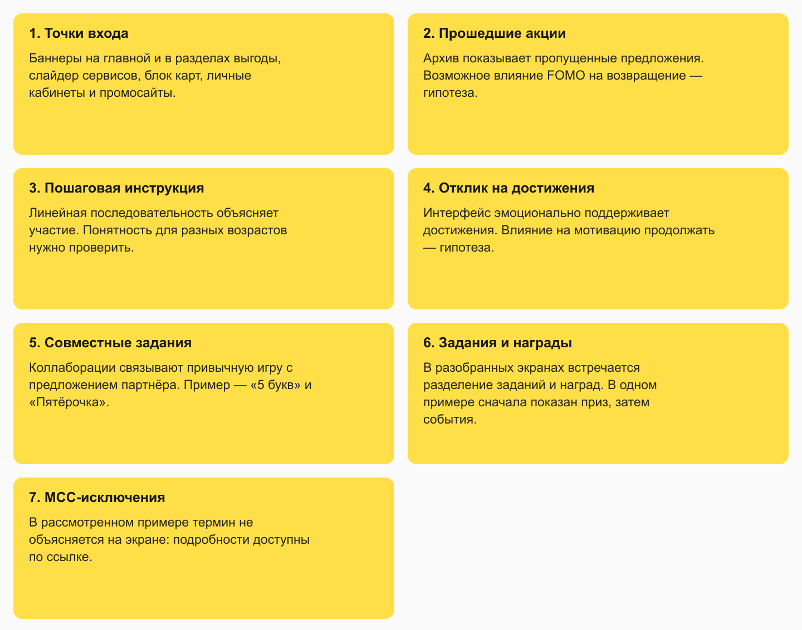
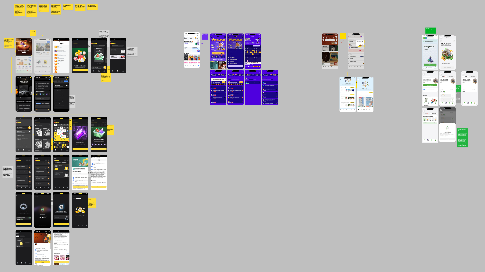

# Бенчмаркинг

Я разобрала примеры заданий, игр и наград в других продуктах: как в них попасть, понять условия, пройти задание и получить приз. Смотрела не только на визуальные решения, но и на формулировки заданий и заголовков.

## Главные выводы

Выводы текстом

- **Точки входа.** Баннеры на главной и в разделах выгоды, слайдер сервисов, блок карт, личные кабинеты и промосайты.
- **Прошедшие акции.** Архив показывает пропущенные предложения. Возможное влияние FOMO на возвращение — гипотеза.
- **Пошаговая инструкция.** Линейная последовательность объясняет участие. Понятность для разных возрастов нужно проверить.
- **Отклик на достижения.** Интерфейс эмоционально поддерживает достижения. Влияние на мотивацию продолжать — гипотеза.
- **Совместные задания.** Коллаборации связывают привычную игру с предложением партнёра. Пример — «5 букв» и «Пятёрочка».
- **Задания и награды.** В разобранных экранах встречается разделение заданий и наград. В одном примере сначала показан приз, затем события.
- **MCC-исключения.** В рассмотренном примере термин не объясняется на экране: подробности доступны по ссылке.

Это наблюдения и интерпретации по разобранным экранам. Бенчмаркинг не подтверждает влияние решений на мотивацию, участие или покупки; эти предположения требуют отдельной проверки.

## Разобранные экраны

[Открыть оригинальный разбор в Figma](https://www.figma.com/design/IqaKUr9wichNDdWqZjb5h2/?node-id=53-405).

Черновой блок для кейса. Основа — семь итоговых жёлтых карточек в строке над разборами на странице «чистовик/сторител»; формулировки сокращены для чтения в кейсе. Перенесено 16.11.2026.
