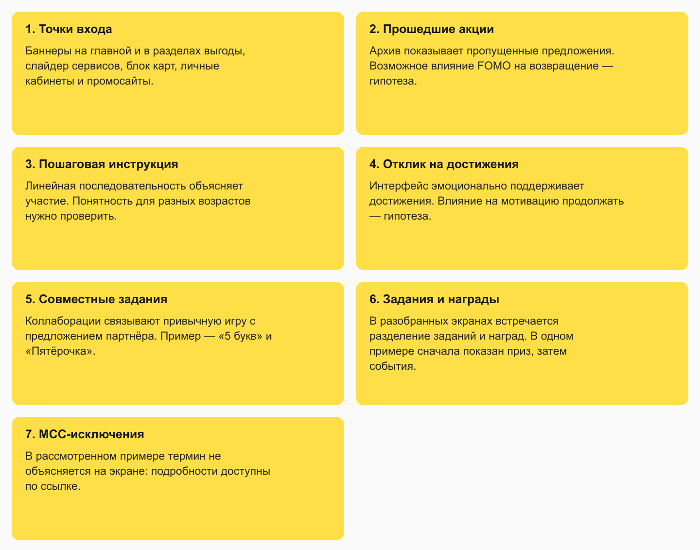
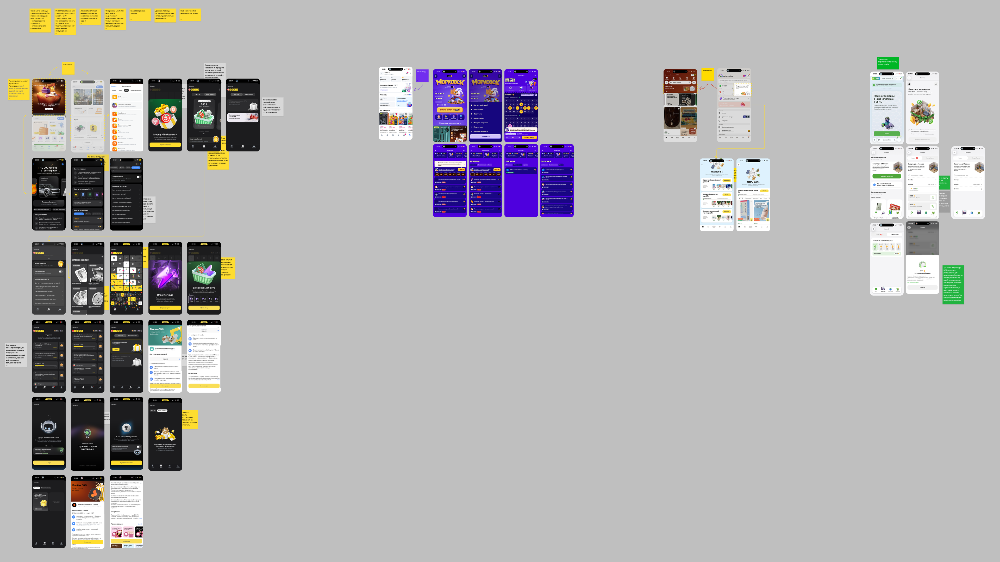

# Альфа-Банк — учебный UX-кейс

Репозиторий хранит материалы всего кейса: бриф, исследование, дальнейшие гипотезы, интервью, дизайн и прототипы. Это независимый учебный проект, не официальный продукт Альфа-Банка.

## Текущий этап

Открытое исследование заданий и игр программы лояльности, включая задания на покупки. Цель этапа — собрать конкретные пользовательские свидетельства до формулирования решений.

**[Открыть таблицу «Проблема → цитата → ссылка и дата»](1-research/open-research.md)**

[Журнал источников и ограничения](1-research/sources.md) · [Реестр источников в JSON](1-research/sources.json)

## Цель кейса

Разработать решение, которое поможет вовлечь пользователей в дополнительные механики программы лояльности и будет способствовать увеличению количества транзакций у партнёров банка. Это цель из брифа, а не доказанный эффект будущего дизайна.

Фокус согласован: задания и игры, в том числе задания на покупки у партнёров. Отдельная механика «Альфа-Кешбэк у партнёров» не входит в текущий сбор. Сообщение пользователя о трудности отделяется от официальных правил и интерпретации исследователя.

## Скринфлоу

[Пути к разделу «Задания и награды» — текст для кейса и увеличенный фрагмент схемы](3-content/screen-flow.md).

## Итоги юзабилити-теста

В тесте участвовали пять человек: они рассмотрели четыре задания, но самостоятельный поиск раздела, чтение условий и начало участия проходили с разными затруднениями.

[Ответы участников и наблюдения по тестам](https://docs.google.com/spreadsheets/d/1_kb33NWPpdOcFdAtIQsjNHxeRmmaByIXZLLBV3dFkw4/edit).

### Раздел легко пропустить

Участники пропускали «Задания и награды» в конце страницы, но я не стала сразу предлагать перенос наверх: сначала нужно понять, оправдано ли отдавать ему место других предложений с точки зрения пользы для пользователей и бизнеса.

### Задания не всегда подходят человеку

Текущие предложения слабо заинтересовали участников; прежде чем предлагать изменения в их подборе, я проверяю по документам банка, как он работает сейчас.

### Неясно, что и в каком порядке делать

Участники понимали общий принцип заданий, но упускали условия и сохраняли сомнения, поэтому я хочу переработать страницу так, чтобы из неё складывалась понятная последовательность: как начать, что выполнить, в какой срок и какую награду получить.

### Нажал «Начать» — что дальше?

После нажатия «Начать» у Маник оставалось сомнение, началось ли задание, поэтому я хочу явно подтвердить старт и эмоционально поддержать человека, который уже потратил усилия на поиск и изучение предложения.

### «MCC-исключения» ничего не объясняют

Термин не помог участникам понять ограничения, поэтому я хочу сначала показать понятные примеры покупок, которые засчитаются в задании, сохранив доступ к исключениям и полным условиям.

### Награда есть, а где её искать?

Участники по-разному представляли, где появится награда, поэтому я хочу проверить постоянно видимую вкладку «Мои награды» рядом с заданиями: до первой награды она будет объяснять эту связь и поддерживать желание начать через понятное пустое состояние.

[Подробные заметки и гипотезы](3-content/ux-test-findings.md).

## Бенчмаркинг

Я разобрала примеры заданий, игр и наград в других продуктах: точки входа, условия участия, получение и использование наград.

[Подробнее о разборе](3-content/benchmark.md) · [Оригинал в Figma](https://www.figma.com/design/IqaKUr9wichNDdWqZjb5h2/?node-id=53-405).

## Материалы

- `1-research/` — исследование и источники.
- `2-design-system/` — материалы дизайн-системы.
- `3-content/` — содержание кейса.
- `4-prototyping/` — прототипы.

Следующие этапы ещё не выполнены. Содержимое исследования хранится в Markdown, чтобы его можно было редактировать в GitHub и позднее перенести на сайт портфолио. Сайт в этом этапе не публикуется.

## Автор и связь

- Имя: Лидия.
- Telegram: [@sellywood](https://t.me/sellywood).
- GitHub: [lsafrazyan6-svg](https://github.com/lsafrazyan6-svg).
- Проект: независимый учебный UX-кейс программы лояльности Альфа-Банка для клиентов банка. Цель из брифа — вовлечь пользователей в задания и игры, включая задания на покупки у партнёров, и способствовать росту транзакций у партнёров.

## Памятка по Git

Репозиторий: https://github.com/lsafrazyan6-svg/alfa-bank-ux-case (закрытый).

16.11.2026 Ивану [Serebrennikovi](https://github.com/Serebrennikovi) отправлено приглашение с правом записи (Write). Принятие приглашения зависит от Ивана.

- Изменить файл — отредактировать рабочую копию; история Git автоматически не пополняется.
- Сохранить версию (commit) — зафиксировать выбранные изменения на компьютере с описанием. К сохранённой версии можно вернуться.
- Отправить (push) — передать сохранённые версии на GitHub участникам с доступом.
- Получить обновления (pull) — перенести изменения с GitHub в свою копию. Перед этим проверить местные изменения, чтобы их сохранить.

Доступ нового чата агента зависит от подключённой папки, аккаунта и его прав. Скиллами и общими материалами можно делиться через репозиторий; их установка не входит в эту задачу. Отправка исходников на GitHub сама по себе не публикует сайт.

В отправку по задаче 02 входят README.md и 02-git.md. Прочие местные изменения требуют отдельного сравнения с GitHub; медиа и секреты в эту отправку не входят.

Осталось: самостоятельно отправить в Telegram, в топик «Проверка», GitHub-ник, ссылку на репозиторий и статус приглашения Ивану.
